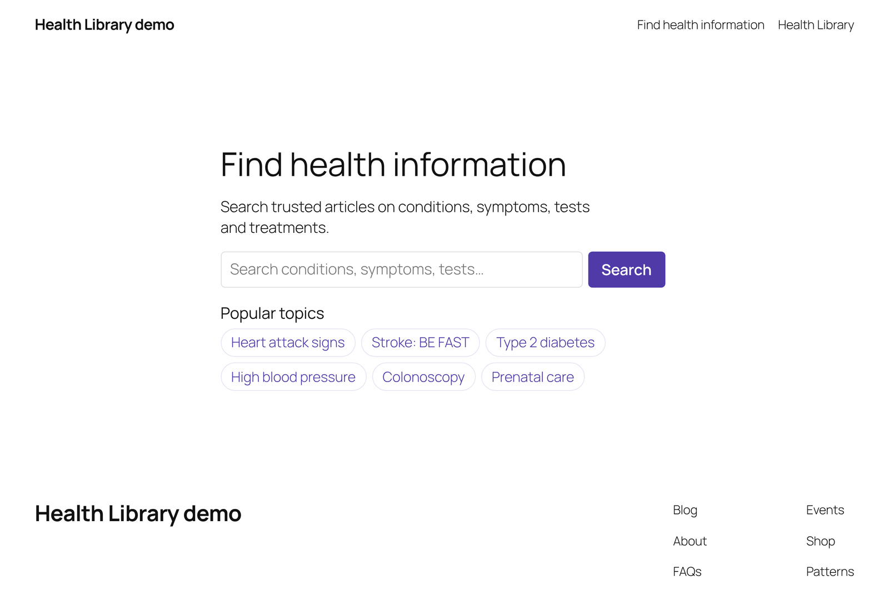
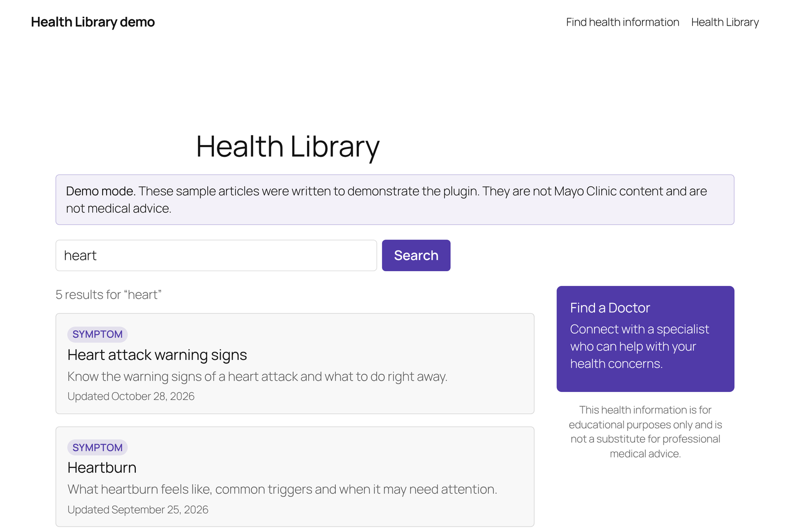
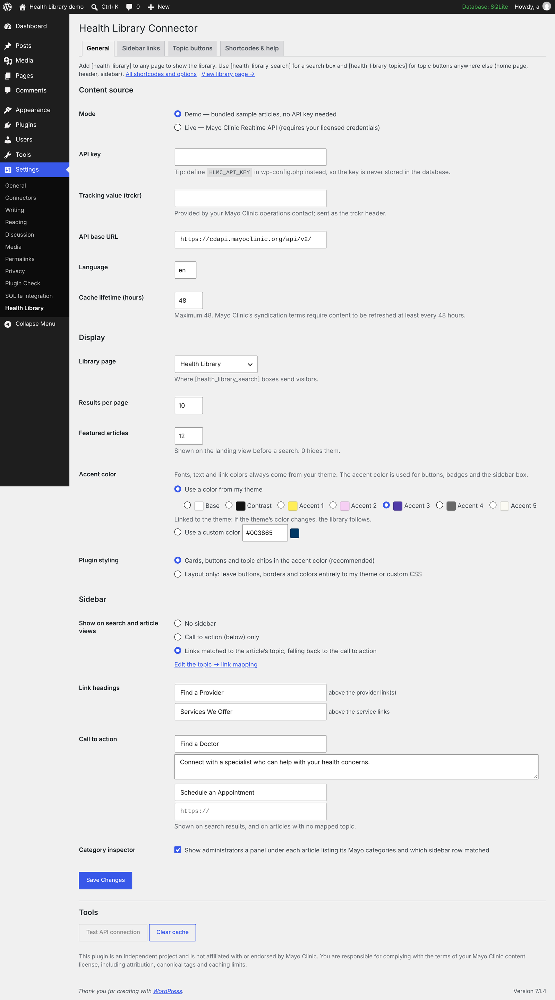
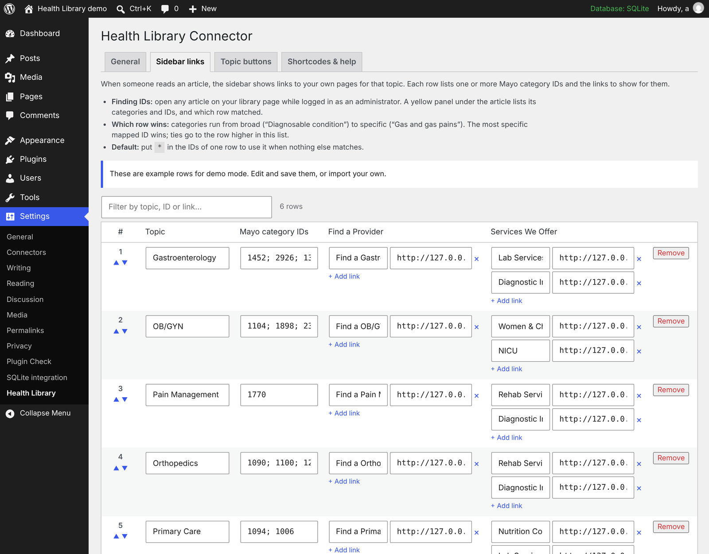
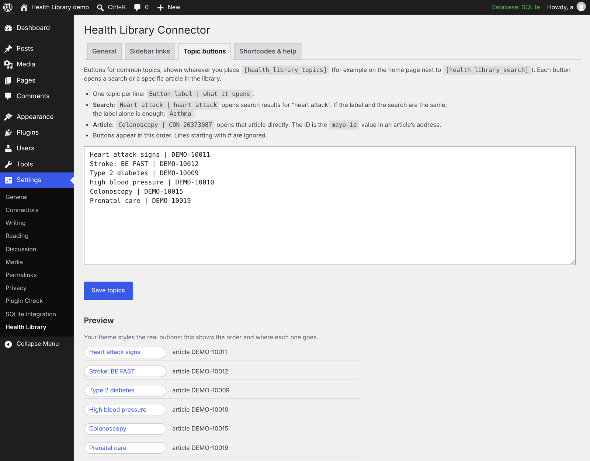
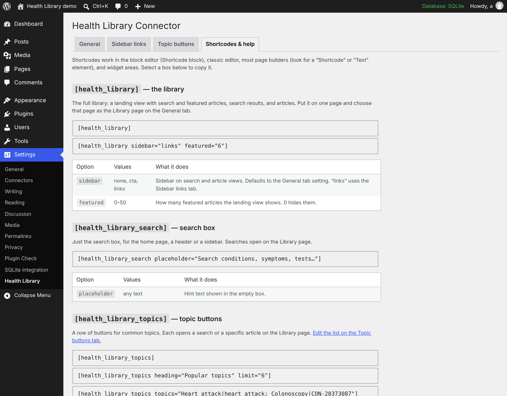
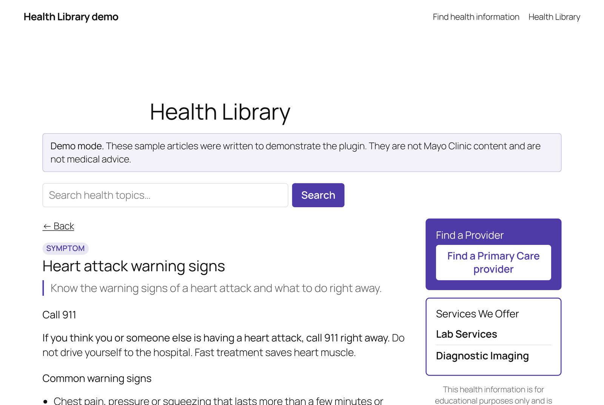
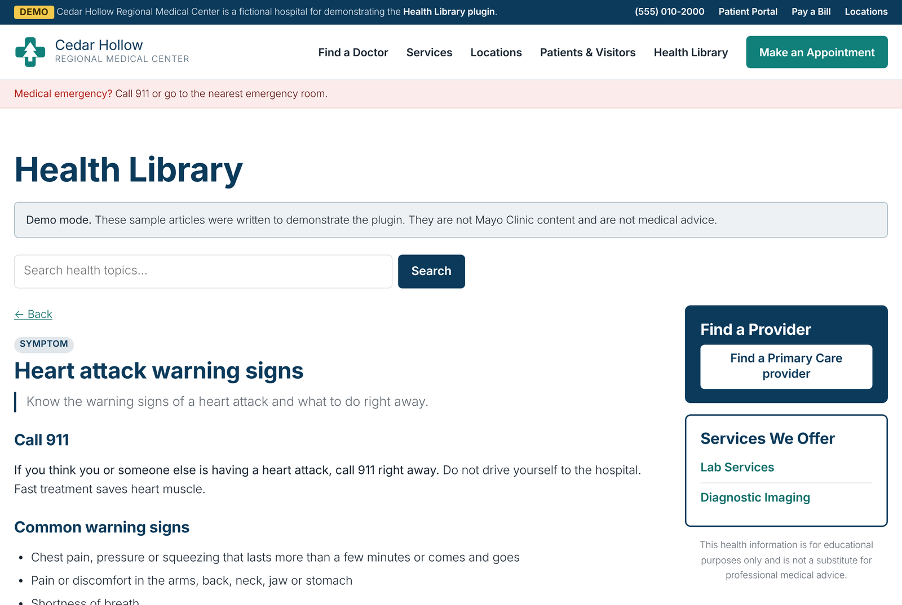

# Pulsegrid Content Connector — WordPress plugin

Display the **Mayo Clinic Health Information Library** on any WordPress site,
inside your own theme, using your organization's licensed Mayo Clinic
Realtime (Content Delivery) API credentials. Visitors search and read articles
without leaving your site.

> **You need your own content license and API key from Mayo Clinic.**
> This repository contains no Mayo Clinic content. It ships with a demo mode
> using original placeholder articles so you can try it first.
>
> This is an independent project. It is not affiliated with, endorsed by, or
> sponsored by Mayo Clinic. "Mayo Clinic" is a trademark of Mayo Foundation
> for Medical Education and Research.

**Live demo:** https://pulsegrid.davidcochran.us (demo mode)

## Features

- `[pulsegrid]` — landing page with featured topics, search with paging, and article pages, all from one shortcode on any page
- `[pulsegrid_search]` — a search box for your header, sidebar or home page
- `[pulsegrid_topics]` — a row of buttons for common topics (each opens a search or a specific article), edited in Settings
- Server-side requests only; the API key never reaches the browser and can live in `wp-config.php`
- Article images proxied and cached server-side (the image endpoint needs authentication)
- License-friendly by default: cache capped at **48 hours**, canonical tag to Mayo's `originalUrl` (also passed to Yoast / Rank Math), "Last reviewed" date, © MFMER notice and Terms of Use link
- Optional sidebar: a call to action, or **links to your own provider and service pages matched to the article's topic**, edited in a table or imported from a spreadsheet
- Matches your theme: fonts, text and links come from the theme, and the accent color can be linked to one of the theme's palette colors; every view can be overridden from your theme
- Demo mode, WP-CLI commands, clean uninstall

## Screenshots

| | |
|---|---|
| <br>`[pulsegrid_search]` and `[pulsegrid_topics]` on a home page | <br>Search results with the call-to-action sidebar |
| <br>Settings: content source, display and theme colors | <br>Sidebar links: map topics to your own pages, or import a CSV |
| <br>Topic buttons | <br>Built-in shortcode reference |

Screenshots use the plugin's demo mode, whose sample articles are original
placeholder text, not Mayo Clinic content.

See [CHANGELOG.md](CHANGELOG.md) for what changed in each version.

## Install

1. Download `pulsegrid-content-connector.zip` from [Releases](../../releases) and upload it under **Plugins → Add New → Upload Plugin**. (GitHub's green **Code → Download ZIP** also installs, but the folder will be named `pulsegrid-content-connector-main`; the release zip keeps the correct folder name for updates.)
2. Activate it, then go to **Settings → Pulsegrid** and click **Create library page**.
3. You'll see demo content. To go live, choose **Live**, add your credentials, save, and click **Test API connection**.

Prefer keeping secrets out of the database:

```php
// wp-config.php
define( 'PGCC_API_KEY', 'your-api-key' );
define( 'PGCC_TRCKR',   'your-trckr-value' );
```

## URLs

| URL | View |
|-----|------|
| `/health-library/` | Landing page with featured topics |
| `/health-library/?mayo-q=diabetes` | Search results (`&mayo-page=2` for paging) |
| `/health-library/?mayo-id=CON-20372695` | Article |

## Shortcode options

```
[pulsegrid sidebar="none|cta|links" featured="12"]
[pulsegrid_search placeholder="Search health topics…"]
[pulsegrid_topics heading="Popular topics" limit="6"]
[pulsegrid_topics topics="Heart attack|heart attack; Colonoscopy|CON-20373087"]
```

Edit the saved topic list under **Settings → Pulsegrid → Topic buttons**, one per line as `Label | search terms` or `Label | CONTENT-ID`. The **Shortcodes & help** tab in the same screen documents every option.

## Sidebar links

On article pages the sidebar can link readers to your own pages for that
topic: a **Find a Provider** link and a list of **Services We Offer**.

Mayo tags every article with category codes (`mcvId`s) that run from broad to
specific, e.g. *Condition › Diagnosable condition `1092` › Pain NOS `1770` ›
Gas and gas pains `2926`*. You map codes to links under **Settings → Health
Library → Sidebar links**:

- Edit rows in the table (topic, one or more codes, provider and service links), reorder them, filter them
- **Import / export CSV** — download the template, fill it in a spreadsheet, save as *CSV UTF-8*, import (merge or replace)
- The **most specific** mapped code on an article wins, so generic codes like `1092` act as a catch-all; ties go to the higher row
- A row with `*` as its code is the default when nothing matches
- Administrators see a **category inspector** under each article listing its codes and which row matched — the easy way to find codes to map

CSV columns: `mcv_ids, topic, provider_label, provider_url, service1_label, service1_url, …`
(several codes in one cell separated by `;`; add `service4_*`, `provider2_*` … as needed).

Rows can also be supplied from code with the `pgcc_care_links` filter.

## Protecting your API quota

Every uncached search, results page or article costs a live API call. The
plugin limits uncached calls to 20 pages per visitor and 120 site-wide per
minute, with a separate 100-per-visitor budget for images (administrators and
WP-CLI are exempt). Adjust with the `pgcc_rate_limits`
filter; behind a CDN or proxy, use `pgcc_client_ip` to read the real visitor
IP from a header you trust (e.g. `CF-Connecting-IP`).

Cached images are stored in `wp-content/uploads/pgcc-cache/` under
unguessable names. Apache is also blocked by an `.htaccess` file there; on
nginx you can add `location ^~ /wp-content/uploads/pgcc-cache/ { deny all; }`.

## Matching your theme

The library is built to look like part of your site, not a widget dropped
into it:

- **Fonts, text and link colors always come from your theme.** The plugin's
  stylesheet never sets them.
- **Accent color from the theme.** Buttons, badges and the sidebar box use
  one of your theme's own palette colors (Settings → Pulsegrid), output
  as `var(--wp--preset--color--<slug>)`, so if the theme's color changes the
  library follows. Works with block themes and with classic themes that
  register an editor color palette. A custom hex color is also available.
- **Layout only.** Turn off the plugin's cards, buttons and chips entirely
  and keep just the columns and spacing; buttons carry the theme's
  `wp-element-button` class so block themes style them.

The same article in two different themes, with no plugin settings changed:

| Twenty Twenty-Five | A hospital theme |
|---|---|
|  |  |

## Customizing

Copy any file from the plugin's `templates/` to
`your-theme/pulsegrid/` and edit it. Spacing and colors use CSS custom
properties (`--pgcc-accent`, `--pgcc-border`, `--pgcc-gap`, …) scoped to
`.pgcc`. `pulsegrid-layout.css` is always loaded;
`pulsegrid.css` (the look) only when Plugin styling is on.

Filters: `pgcc_source`, `pgcc_template`, `pgcc_allowed_html`,
`pgcc_care_links`, `pgcc_care_links_match`, `pgcc_is_library_page`,
`pgcc_rate_limits`, `pgcc_client_ip`.
Actions: `pgcc_cache_cleared`, `pgcc_rate_limited`.

## WP-CLI

```bash
wp pulsegrid status
wp pulsegrid test
wp pulsegrid cache clear
```

## Your license obligations

The plugin builds in the display and caching requirements we know of from
Mayo's syndication terms, but **your license agreement is what counts**.
Check the required attribution wording and override
`templates/attribution.php` if yours differs.

## Repository layout

| Path | What it is |
|------|------------|
| repo root | The plugin itself — the root is the plugin folder, so GitHub's zips install directly |
| `docs/` | Screenshots for this README (left out of downloads) |
| `prototype/` | The original standalone PHP prototype the plugin grew out of — reference only, **not for deployment**; left out of downloads |

The early commits are the prototype's development history, reconstructed
from the working sessions it was built in (timestamps are approximate).

## License

GPL-3.0-or-later. See [LICENSE](LICENSE).
